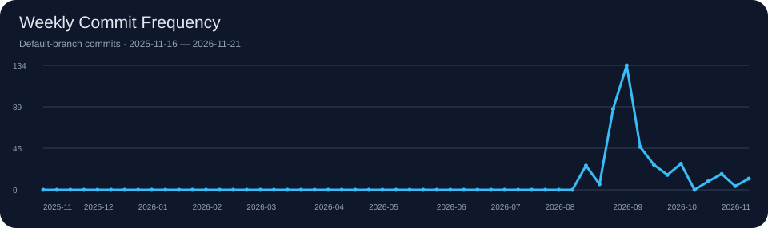

<!-- CONTRIBUTIONS:START -->

<!-- CONTRIBUTIONS:END -->

## 🌟 精选项目

<!-- FEATURED:START -->
跟随 GitHub 主页置顶仓库，按置顶顺序展示。

| 仓库 | 简介 | 语言 | Stars | Forks |
| --- | --- | --- | ---: | ---: |
| [luskyle/pupu](https://github.com/luskyle/pupu) | 一款多平台内容发布浏览器扩展，一次编辑，轻松将内容同步发布到多个社交平台。 | TypeScript | 0 | 1 |
| [luskyle/DAO](https://github.com/luskyle/DAO) | 天道常在 | CSS | 0 | 0 |
| [luskyle/mmax-video](https://github.com/luskyle/mmax-video) | 暂未填写仓库简介。 | JavaScript | 0 | 0 |
<!-- FEATURED:END -->

## 🔨 最近维护

<!-- RECENT:START -->
- **[luskyle](https://github.com/luskyle/luskyle)** · 最近推送 2026-11-27
  暂未填写仓库简介。
- **[damn-clock-in](https://github.com/luskyle/damn-clock-in)** · 最近推送 2026-11-23
  暂未填写仓库简介。
- **[mmax-video](https://github.com/luskyle/mmax-video)** · 最近推送 2026-11-21
  暂未填写仓库简介。
<!-- RECENT:END -->

## 📦 最新发布

<!-- RELEASES:START -->
- 2026-11-21 · **mmax-video** · [v1.0.1](https://github.com/luskyle/mmax-video/releases/tag/v1.0.1)
- 2026-11-21 · **mmax-video** · [v1.0.0](https://github.com/luskyle/mmax-video/releases/tag/v1.0.0)
- 2026-11-18 · **sing-japanese** · [v0.4.0](https://github.com/luskyle/sing-japanese/releases/tag/v0.4.0)
- 2026-11-17 · **sing-japanese** · [v0.3.1](https://github.com/luskyle/sing-japanese/releases/tag/v0.3.1)
- 2026-11-17 · **sing-japanese** · [v0.3.0](https://github.com/luskyle/sing-japanese/releases/tag/v0.3.0)
<!-- RELEASES:END -->

## 📊 GitHub 统计图表

<!-- PROFILE:START -->
| 公开仓库 | Followers | Following | 原创仓库 Stars |
| ---: | ---: | ---: | ---: |
| 16 | 9 | 4 | 23 |
<!-- PROFILE:END -->

### 📈 每周提交频率

<!-- COMMITS:START -->

<!-- COMMITS:END -->

## 🚀 热门原创仓库

<!-- REPOSITORIES:START -->
| 仓库 | 简介 | 语言 | Stars |
| --- | --- | --- | ---: |
| [Solutions](https://github.com/luskyle/Solutions) | 面向工控 / 上位机桌面软件开发的专题集与素材库（2017 年起积累）。 | JavaScript | 13 |
| [kicad-mcp](https://github.com/luskyle/kicad-mcp) | 这是一个带 kicad-mcp 的 KiCad 源码仓库：在标准 KiCad 之上，增加了 MCP（Model Context Protocol）能力 —— 让 AI 助手通过自然语言直接控制 KiCad 绘制/检查/仿真原理图与 PCB，实现"你说电路，AI 画图"。 | C++ | 2 |
| [mmax-video](https://github.com/luskyle/mmax-video) | — | JavaScript | 0 |
| [sing-japanese](https://github.com/luskyle/sing-japanese) | — | C++ | 0 |
| [DAO](https://github.com/luskyle/DAO) | 天道常在 | CSS | 0 |
| [luskyle](https://github.com/luskyle/luskyle) | — | JavaScript | 0 |
<!-- REPOSITORIES:END -->

## 📬 联系我

<!-- CONTACT:START -->
[GitHub · luskyle](https://github.com/luskyle) · [公开邮箱](mailto:844804539%40qq.com)
<!-- CONTACT:END -->

---

<!-- DOCUMENT_UPDATED:START -->
文档更新时间：2026-11-27（UTC）
<!-- DOCUMENT_UPDATED:END -->
