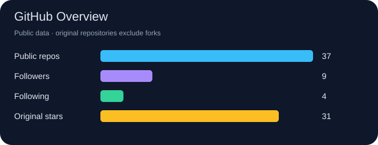
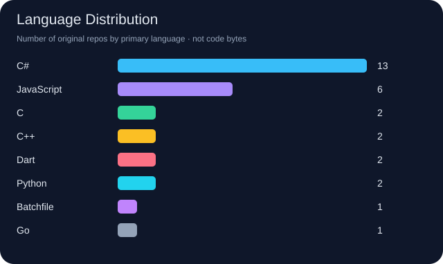
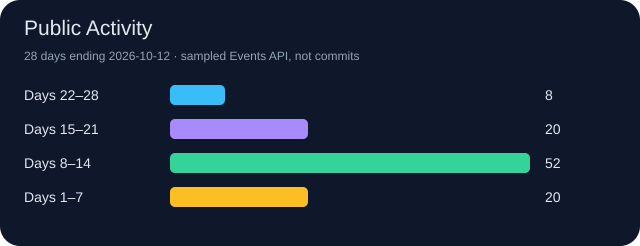

# 你好，我是 Luskyle 👋

> 渺万里层云，千山暮雪。

欢迎来到我的 GitHub 主页！这里记录我的开源项目、开发工具与探索过程。

[个人主页](https://github.com/luskyle) · [所有仓库](https://github.com/luskyle?tab=repositories) · [精选项目](#-精选项目) · [统计图表](#-github-统计图表)

## 🧭 关于我 · 正在做 / 正在学

<!-- ABOUT:START -->
- **关注方向：** 工控 / 上位机开发素材、开发工具与浏览器扩展
- **正在做：** 维护下方列出的公开项目；具体计划待补充。
- **正在学：** 待补充（不根据仓库语言推断学习计划）。
<!-- ABOUT:END -->

## 🛠️ 技术栈与工具

这里展示公开项目涉及的语言和本仓库使用的工具，不代表熟练度评级。

## 🌟 精选项目

<!-- FEATURED:START -->
### [Solutions](https://github.com/luskyle/Solutions)

面向工控 / 上位机桌面软件开发的专题集与素材库（2017 年起积累）。

**资料 / 文档** · ⭐ 13 · Forks 3

### [pupu](https://github.com/luskyle/pupu)

一款多平台内容发布浏览器扩展，一次编辑，轻松将内容同步发布到多个社交平台。

**TypeScript** · ⭐ 0 · Forks 1

### [antelope](https://github.com/luskyle/antelope)

小巧敏捷的 C/C++ 编译链接工具。用一份或多份 JSON 配置描述构建目标，把项目编成静态库、共享库或可执行程序；不生成 makefile，也不引入额外的构建语言。最重要的是，你可以与cmake说拜拜了

**Python** · ⭐ 0 · Forks 0
<!-- FEATURED:END -->

## 🔨 最近维护

<!-- RECENT:START -->
- **[luskyle](https://github.com/luskyle/luskyle)** · 最近推送 2026-10-12
  暂未填写仓库简介。
- **[pupu](https://github.com/luskyle/pupu)** · 最近推送 2026-10-10
  一款多平台内容发布浏览器扩展，一次编辑，轻松将内容同步发布到多个社交平台。
- **[antelope](https://github.com/luskyle/antelope)** · 最近推送 2026-10-10
  小巧敏捷的 C/C++ 编译链接工具。用一份或多份 JSON 配置描述构建目标，把项目编成静态库、共享库或可执行程序；不生成 makefile，也不引入额外的构建语言。最重要的是，你可以与cmake说拜拜了
<!-- RECENT:END -->

## 📦 最新发布

<!-- RELEASES:START -->
- 2026-10-10 · **pupu** · [v0.3.0](https://github.com/luskyle/pupu/releases/tag/v0.3.0)
- 2026-10-09 · **antelope** · [v1.4](https://github.com/luskyle/antelope/releases/tag/v1.4)
- 2026-10-08 · **antelope** · [v1.3](https://github.com/luskyle/antelope/releases/tag/v1.3)
- 2026-09-29 · **moz** · [vscode-dxf-viewer-v0.2.4](https://github.com/luskyle/moz/releases/tag/vscode-dxf-viewer-v0.2.4)
- 2026-09-29 · **moz** · [vscode-dxf-viewer-v0.2.3](https://github.com/luskyle/moz/releases/tag/vscode-dxf-viewer-v0.2.3)
<!-- RELEASES:END -->

## 🤝 开源贡献 · 最近 Pull Request

<!-- PULL_REQUESTS:START -->
- [aalhour/C-Sharp-Algorithms#105](https://github.com/aalhour/C-Sharp-Algorithms/pull/105) · Create README-zh.md · **已关闭**
- [luskyle/Solutions#1](https://github.com/luskyle/Solutions/pull/1) · New Merge OR Delete · **已合并**
- [luskyle/PrimitiveGenerationSystem#1](https://github.com/luskyle/PrimitiveGenerationSystem/pull/1) · Create LICENSE · **已合并**
<!-- PULL_REQUESTS:END -->

## 📚 最新文章

<!-- BLOG:START -->
尚未配置博客 RSS。添加 `profile.config.json` 中的 `rssFeeds` 后，这里将自动展示最新文章。
<!-- BLOG:END -->

## 📊 GitHub 统计图表

<!-- PROFILE:START -->
| 公开仓库 | Followers | Following | 原创仓库 Stars |
| ---: | ---: | ---: | ---: |
| 37 | 9 | 4 | 31 |
<!-- PROFILE:END -->

语言图按**仓库主要语言的数量**统计，不表示代码行数、代码体积或个人熟练度。

活动图统计 Events API 样本中以最新事件日期为终点的 28 天，按周分组；
不是提交数量或完整贡献历史。

## 🟩 贡献日历与连续记录

<!-- CONTRIBUTIONS:START -->

过去一年 **441** 次贡献 · 当前连续 **1** 天 · 最长连续 **4** 天（此日历范围内）。

🐍 贡献蛇动画

动画沿近期活跃日期移动，不表示提交顺序；不支持 SVG 动画的客户端会显示静态日历。

<!-- CONTRIBUTIONS:END -->

## 🚀 热门原创仓库

<!-- REPOSITORIES:START -->
| 仓库 | 简介 | 语言 | Stars |
| --- | --- | --- | ---: |
| [Solutions](https://github.com/luskyle/Solutions) | 面向工控 / 上位机桌面软件开发的专题集与素材库（2017 年起积累）。 | — | 13 |
| [luskyle](https://github.com/luskyle/luskyle) | — | — | 0 |
| [pupu](https://github.com/luskyle/pupu) | 一款多平台内容发布浏览器扩展，一次编辑，轻松将内容同步发布到多个社交平台。 | TypeScript | 0 |
| [antelope](https://github.com/luskyle/antelope) | 小巧敏捷的 C/C++ 编译链接工具。用一份或多份 JSON 配置描述构建目标，把项目编成静态库、共享库或可执行程序；不生成 makefile，也不引入额外的构建语言。最重要的是，你可以与cmake说拜拜了 | Python | 0 |
| [qiuniu](https://github.com/luskyle/qiuniu) | — | JavaScript | 0 |
| [moz](https://github.com/luskyle/moz) | — | C++ | 0 |
<!-- REPOSITORIES:END -->

## 📝 最近公开活动

<!-- ACTIVITY:START -->
- 2026-10-12 · 创建 branch `main` · [luskyle/luskyle](https://github.com/luskyle/luskyle)
- 2026-10-10 · 推送代码到 [luskyle/pupu](https://github.com/luskyle/pupu)
- 2026-10-10 · 推送代码到 [luskyle/pupu](https://github.com/luskyle/pupu)
- 2026-10-10 · Star [espressif/esp-idf](https://github.com/espressif/esp-idf)
- 2026-10-10 · 推送代码到 [luskyle/antelope](https://github.com/luskyle/antelope)
<!-- ACTIVITY:END -->

## 📬 联系我

<!-- CONTACT:START -->
[GitHub · luskyle](https://github.com/luskyle) · [公开邮箱](mailto:844804539%40qq.com)
<!-- CONTACT:END -->

---

文字与统计图每 6 小时自动刷新，也支持手动更新。图片由本仓库生成，无第三方统计图片服务。
动态区域外的文字可以自由编辑；个人方向、技术标签和 RSS 可通过配置文件调整。
配置与部署方法见 [自动更新说明](./docs/automation.md)。
